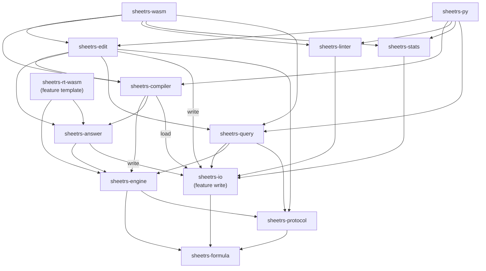

# Architecture Documentation

The **SheetRS Suite** is organized as a Cargo workspace containing a shared kernel (`sheetrs-io`), the tool crates (library plus executable) and the bindings. This architecture promotes code reuse, consistency, and testability.

## Reference Behavior

The reference behavior of the compiler, the runtime and the modifications of `sheetrs edit` is **LibreOffice 26.8 on Linux**. What an operation gives where the formats or the applications differ is what LibreOffice gives for it (`sheetrs-compiler/docs/FIDELITY.md`).

## Workspace Structure

```
sheetrs/
├── sheetrs-io/       # Input of the suite: workbook model + XLSX/ODS readers (was sheetrs-core); feature `write`: the XLSX/ODS writers
├── sheetrs-formula/    # Lossless formula AST (parse, print, rewrite references)
├── sheetrs-protocol/   # The contract: typed requests/responses of run, query, find, replace
├── sheetrs-cli/        # The `sheetrs` executable: `query`, `edit`, `lint`, `stats`
├── sheetrs-linter/     # Rules, configuration, violations (lib) + `lint` subcommand (feature `cli`)
├── sheetrs-stats/      # Workbook metrics (lib) + `stats` subcommand
├── sheetrs-query/      # Reading and finding cells by range, sheet or workbook (lib) + `query` subcommand
├── sheetrs-engine/     # IR, function library, run-time evaluation, `sheetrs-rt`
├── sheetrs-compiler/   # Loader, dependency analysis, folding, `sheetc`
├── sheetrs-answer/     # The answer of a program written into the workbook it was made from (`fill_template*`)
├── sheetrs-edit/       # Workbook modification (lib) + `edit` subcommand
├── sheetrs-wasm/       # Bindings for the browser (wasm-bindgen): every tool, and the compiler to WebAssembly
├── sheetrs-rt-wasm/    # The base module of the WebAssembly target of `sheetc` (the runtime, no program)
├── sheetrs-py/         # Bindings for Python (PyO3, maturin)
└── Cargo.toml          # Workspace configuration
```

## Layering

The suite follows a hexagonal (ports and adapters) layout. A **tool crate** is an application
core: it owns the decisions about a workbook (the linter's rules, the statistics, the edit
operations, the compilation) and exposes them as a Rust library. Around it:

- **Driven side** (what a tool needs): the workbook model and the readers of `sheetrs-io`. The
  model (`Workbook`, `Cell`, `Grid`, `CellSink`, `WorkbookReader`) is the port; the XLSX and ODS
  parsers are its adapters. A tool never sees a file format.
- **Driving side** (who calls a tool): the executables (`sheetrs`: `query`, `edit`, `lint`, `stats`;
  `sheetc`) and the bindings (`sheetrs-wasm`, `sheetrs-py`). Each is an adapter that translates
  arguments and renders results; none holds a decision. What several adapters need to present
  (violations grouped by sheet and cell, flat records) is part of the tool's library
  (`sheetrs_linter::report`), not copied into each adapter.

Dependencies point inward: adapters → tool libraries → `sheetrs-io` / `sheetrs-formula` /
`sheetrs-protocol`. Tool crates do not depend on each other, with these deliberate exceptions:

- `sheetrs-edit` depends on `sheetrs-query`, because a replacement is a search followed by a
  write, and the two must agree on which cells a search finds (its matcher and the text of a cell
  that a search sees live in `sheetrs-query`; the writing is `sheetrs_io::write`).
- `sheetrs-edit` depends on `sheetrs-compiler` (and so on the engine): a conversion of formulas to
  values after a change that leaves cached results stale, and the `calculate` step, call the engine
  directly, with the semantics of `LibreOffice`. Nothing is injected, and `sheetrs edit` carries the
  engine (the executable is larger by what the engine is: the sizes are in `docs/performance.md`).
- `sheetrs-compiler` and `sheetrs-edit` both depend on `sheetrs-answer`, the code that runs a
  program over a workbook and writes the answer into it (`fill_template*`); it depends on the
  engine and on the writers of `sheetrs-io`, and on nothing of the compiler or the editor.

The writers are a **feature** of the kernel, `sheetrs-io/write`, off by default: the tools that only
read (`sheetrs lint`, `sheetrs stats`, `sheetrs query`, the compiler without its loader) do not compile them.
The crates that write enable it (`sheetrs-answer`, `sheetrs-edit`).



(The direct edges between the workspace crates, except those to `sheetrs-formula` of the crates that
read formulas and the edges of the bindings to `sheetrs-io`, `sheetrs-engine` and `sheetrs-protocol`.)

### What belongs in `sheetrs-protocol`

`sheetrs-protocol` is the **contract** of the suite as typed JSON, with no behaviour: it depends
on `sheetrs-formula` (the grammar of references), `serde` and `serde_json`, so a client (a web
page, a Python program, another service) can speak the protocol without any tool.

| Module | What it says |
| ------ | ------------ |
| `run` | The request a compiled program answers (`inputs`, `ranges`, `majorDimension`) and its response (`valueRanges`). `sheetrs-engine` parses its requests with it |
| `query` | `Query` (scopes: workbook, a sheet, a range; properties: `value`, `formula`, `number_format`, `display`; an optional `Find`; a locale), `CellRecord`, `QueryResponse` |
| `find` | `Find` (text, mode literal/regex/wildcards, match case, entire cells, search in value or formula, `include_formulas`, `formatted`, `filtered`) and `Replace` (a `Find` and the text that takes its place) |
| `reference` | A range as a caller writes it (`'My Sheet'!B2:C9`) |

The array of a cell is not a property: a query does not say whether a formula is an array
formula, and a selective read does not know it.

### What belongs in `sheetrs-io`

`sheetrs-io` (named `sheetrs-core` before 0.4.0) is the **input side** of the suite and a **shared kernel**, not "the public library": the public surface of the suite is
every library crate and every binding. A module is in the kernel when at least two tools need it
and it has no meaning outside the workbook model. The test, applied to the code that was in the
crate:

| Code | Used by | Decision |
| ---- | ------- | -------- |
| `reader` (model, `Grid`, `CellSink`, XLSX/ODS parsers), `ExcelError` | linter, stats, compiler, edit | kernel |
| `reader::parser_utils`, the XLSX shared-formula and part-name helpers the writers reuse | readers and writers | kernel |
| `rules`, `config`, `violation`, `report`, `Linter` | linter only (rules exist only to be run by it) | `sheetrs-linter` |
| `write` (XLSX/ODS stream rewriting, `ValueScope`, `CellWrites`), behind the feature `write` | edit and answer (the compiler through it) | kernel, as an optional feature: the code that touches the file format stays where the formats are, and no tool that only reads compiles it |
| `EntryFormat` (how a cell's text is entered), the calendar arithmetic | query, edit, engine | kernel (`sheetrs-io`) and `sheetrs-formula::calendar` |

Moving code out of the kernel is how its boundary stays honest: a feature of one tool (a new rule,
a new edit operation) never changes `sheetrs-io`, and a second consumer of a tool's code is
served by that tool's library, not by growing the kernel. Reading is shared because four crates
read workbooks. Writing was the editor's while one crate wrote; when the compiler's answer had to
be written into a workbook too, the writers moved down to `sheetrs-io` behind the feature `write`
(the edit operations stay in `sheetrs-edit`, the format mechanism is where the readers are), instead
of one tool crate depending on the other.

## 1. sheetrs-io

The input of the suite and its shared kernel: the format-agnostic workbook model and the streaming readers that fill it.

- **`Book`** (`book.rs`, the one interface of the suite): a workbook that is a reference: where it
  comes from (a file, or the bytes of one), its `Format` (read from the content, never from the
  extension or an argument), its locale (`with_locale`, `locale`, `default_locale`, the system's: the tools that give
  a text to a number follow it, see *The locale of a `Book`* in `docs/coding-patterns.md`) and, with the
  feature `write`, the operations pending on it. It reads nothing
  until a tool does, so it is cheap to make and to clone, and it is not a model of the workbook (that is
  `Workbook`, `Book::workbook()`). Every tool is a trait to import that adds what it does to a `Book`
  (`BookQuery`, `BookEdit`, `BookCompile`, `BookLint`, `BookStats`); `Book::push`, `operations` and
  `clear_operations` are the seam they use. The data of the operations (`write::Operation`,
  `ReplaceSpec`, `Calculation`) lives next to the writers.
- **`locale`**: `LocaleTag` (a language and a region, `FromStr`), the locale of the system as
  `LibreOffice` reads it on Linux (`system`, `from_environment`) and, with the feature `config`, the
  `locale` of a `sheetrs.toml` (`from_config`). What a tag means (separators, names) is the engine's table.
- **`reader`**: Abstracts over file formats (XLSX, ODS) and holds `Format`; the free functions that read
  from a path or a reader are internal: a `Book` is the way in.
  - Uses `zip` and matching XML parsers (`quick-xml` or custom) for efficient data reading.
  - Custom stream-based parsing logic for both formats ensures minimal memory footprint.
  - `WorkbookReader` is the common interface of the formats. Its one required method for cells,
    `read_sheets_into(sink)`, hands each cell to a `CellSink` as it is parsed; every consumer of
    the readers gets its cells that way, so a change in how a format is read is made once.
  - `Grid<T>` (`reader/grid.rs`) is the one store of cells: a sorted list of columns and items per
    sheet with the offset where each row starts. The linter's `Sheet.cells` is a `Grid<Cell>`
    (filled by the default `GridSink`, with no intermediate map) and the compiler's model keeps a
    `Grid<ModelCell>` per sheet in its own `CellStore`. Reading in row order appends; a walk is
    in row order. A `Cell` holds the value, formula, array flag and number format, and not its own
    position: the position is the cell's place in the `Grid`, which iteration and `CellSink::cell`
    hand over with it. The cell is 56 bytes (the hash map's entry was 80 plus its table).
  - **Notes and arrays.** `Properties.comment` asks a selective read for the text of the notes, given
    to `CellSink::comment` **before** its cell (a note can sit on a cell that has nothing else, so the
    cell may not follow): XLSX legacy comments (rich runs joined) and ODS `office:annotation`. Every
    cell of the range of an array formula carries its formula and `Cell::is_array`, the interior
    cells too, as `LibreOffice` shows them.
  - **The syntax of a formula is the file's own** in what the readers hand to a sink
    (`Book::workbook_into`, `Book::selection_into`): Excel's in an XLSX, `OpenFormula` in an ODS
    (`[.A1]+[$T.B2]`, without the `of:=`). What `LibreOffice` shows depends on it (an ODS keeps
    sheets that are relative, `T.A1`, and ranges that name their sheet twice), so `sheetrs-query` and
    `sheetrs-edit` work on the native text. The tools that analyse the text of formulas (the linter, the
    compiler) work on an **analysis form**, Excel's notation for both formats, through
    `Book::analysis_into` / `Book::workbook` (the `ExcelFormulas` sink converts an ODS formula
    once, with the name of its sheet); the `Workbook` model is that form. The statistics only
    count cells, so they read the native text (`Book::workbook_into`) and skip that conversion.
  - `Selection` (sheets, `Window`s of rows and columns, and the `Properties` wanted of each cell) is
    what a selective read takes: `Book::selection_into(selection, sink)` does not parse a sheet that
    is not selected, stops the reading of a sheet after the last row a window reaches (an ODS ends
    with the last table selected), skips the cells outside the windows and does not build the
    properties that were not asked for. A cell reaches the sink as in a full read, so the two agree
    on what a cell is (the tests compare them in each format). XLSX rows are expected in
    ascending order, as Excel requires.
  - `SheetState` (`Visible`, `Hidden`, `VeryHidden`) is what a sheet's `state` says; an ODS has the
    first two.
  - `ExcelError` is the error value a cell can hold (`#DIV/0!`, …).

## 1b. sheetrs-formula

A dependency-free crate with the formula **AST**: it keeps what analysis and
rewriting need (absolute `$` markers, the function name as written, the text of
numbers, explicit parentheses, omitted arguments) and nothing engine-specific.

- `parse`: single-pass Pratt parser for Excel syntax (the analysis form of the readers).
- `calc_print` / `calc_read`: a formula in the notation `LibreOffice` shows it, from what a file keeps
  (`native_to_calc`, which depends on how the file wrote it: an XLSX has only absolute sheets, an ODS
  keeps relative ones) and back to the notation of a file (`from_calc`); `compile_calc` is what
  `LibreOffice` makes of a text typed as a formula (errors, lowercase names, closed parentheses).
- `print`: canonical spelling; `parse(print(parse(s))) == parse(s)`.
- `parse_spanned`: keeps the source and the span of every reference, so
  whitespace and spelling are recoverable and `Formula::rewrite` applies an edit
  by replacing only the references that change.
- `edit`: what a formula becomes when rows or columns are inserted or deleted
  or a sheet is renamed or deleted (`#REF!` for what disappears, ranges that
  shrink and grow).

Lint rules still use string heuristics (`rules/helpers.rs`); migrating them to
the AST is incremental and not part of this crate's introduction.

## 1c. sheetrs-engine and sheetrs-compiler

Two crates, split along the line that matters for reuse and build time:

- **`sheetrs-engine`** executes a compiled `Program` (the format-independent IR)
  with JSON in and JSON out: values, the function registry, dates, text conversion, collation, search patterns and the
  demand-driven evaluator. It knows nothing about XLSX or ODS and does not
  depend on the readers; its binary `sheetrs-rt` is the stub a compiled
  executable is made from.
- **`sheetrs-answer`** runs a program over its own workbook (`fill_template`, `fill_template_to`,
  and the `_with_answer` forms) and writes the results and the inputs into it with the writers of
  `sheetrs-io`: the workbook is the template of its answer. It sits between the engine and the
  writers, and `sheetc`, the editor and the WebAssembly base module use it.
- **`sheetrs-compiler`** turns a workbook into a `Program`: `loader` (the only code
  that knows the file format, on top of `sheetrs-io`) → `Model` → lowering of the
  `sheetrs-formula` AST to the IR → cone of influence, SCC order, constant
  folding. Its binary is `sheetc`.

The date system (one of three, `DateSystem`: 1899-12-30, 1900-01-01 and 1904-01-01; another is an
error), iteration, search settings and reference syntax come from the document;
see [sheetrs-compiler/docs/DESIGN.md](sheetrs-compiler/docs/DESIGN.md) and
[sheetrs-compiler/docs/FIDELITY.md](sheetrs-compiler/docs/FIDELITY.md).

## 1d. Reading cells: selections and the query tool

The readers can read **what is asked and nothing else** (`reader::Selection`): a window of rows
and columns per sheet (or one for every sheet), and the properties wanted (`value`, `formula`,
`number_format`). A sheet that is not selected is not parsed, the reading of a sheet stops after the
last row a window reaches (an ODS ends with the last table selected), cells outside the windows
are skipped, and a property not asked for is not built. `sheetrs-query` is the tool on top of
it, which gives for each file the result LibreOffice gives.

Two texts of a cell are different things and `sheetrs-query::text` keeps them apart: what a person
**sees** (`display`: the value written with its number format, in a locale) and what a **search**
sees (the text of the input line of the cell: `1234.5` for a cell that shows `1,234.50`, `25.6%`,
the date `03/15/2023`, and for a formula the notation of LibreOffice, `=SUM(A1,B1)`). Number
formats are read for every family of data style of an ODS (`reader::ods_styles`) and written as the
format code an XLSX holds for the same cell. A LibreOffice error that Excel does not have
(`Err:502`, `Err:522`) keeps its code in an ODS (`ExcelError::Libre`) and is `#VALUE!` in an XLSX,
as LibreOffice itself writes it.

## 2. Tools

Each tool is a crate `sheetrs-<tool>`: a library with the tool's logic and, behind the `cli` feature, its subcommand (`src/cli.rs`: the clap
`Args` and `run`). The `sheetrs-cli` crate only assembles the four subcommands into the `sheetrs` executable; the
libraries stay free of clap when the feature is off (`sheetrs-wasm` and `sheetrs-py` do not enable it).

- **`sheetrs lint`** (crate `sheetrs-linter`):
  - `rules`: each rule is a standalone struct implementing `WalkerRule`; the `WorkbookWalker`
    runs them in a single pass; they are registered in `rules::registry`, which is also the
    catalog of rules (the rules exist only inside the linter).
  - Categories: `ERR` (Errors), `CALC` (Calculations), `REF` (References), `INT` (Interruptions), `CPX` (Complexity), `VUL` (Vulnerability), `DATA` (Data Issues), `EXT` (External), `HID` (Hidden), `FILE` (Files), `VBA` (Macros).
  - `config`: TOML configuration. Hierarchical loading: Default -> Global Config -> Sheet
    Overrides; rules enabled or disabled by ID or category.
  - `violation`: `Violation`, `RuleId`, `Severity`, `ViolationScope`.
  - `report`: `group_by_scope` (book → sheet → cell, one entry per sheet) and `ViolationRecord`
    (flat form for the bindings).
  - `Linter` runs the rules over a `Workbook` it is given; it reads nothing.
    A `LinterConfig` is valid by construction (parsing validates: unknown rules, categories or
    parameters are an error), so no adapter validates it again.
  - `human`, `json`, `sarif` and `output`: the three output formats (`--format human|json|sarif`,
    human by default) are library functions over the violations (`write_human`, `write_json`,
    `write_sarif`, and `output::write_report` over an `OutputFormat`), so the CLI, the WebAssembly
    package and Python write the same text for the same run; SARIF 2.1.0 is validated in the tests
    against the official schema. `main.rs` and `formatter.rs` take the arguments and pick stdout.

- **`sheetrs stats`** (crate `sheetrs-stats`):
  - Focuses on aggregating metrics.
  - Uses the same `Workbook` model but collects different data points (counts, distributions).
  - `stats.rs`: `BookStats::stats` computes workbook and per-sheet metrics in one streaming pass
    and is what the bindings call; it takes nothing because there is nothing to configure.
    `main.rs` handles arguments and output.

- **`sheetrs edit`** (crate `sheetrs-edit`):
  - The writers (`sheetrs_io::write`, feature `write`) stream-edit the archive with `zip` and `quick-xml` (deleting sheets, names, rows and
    columns, converting formulas to values) without fully rewriting the file, applying the
    same changes to each format; they have their own error (`sheetrs_io::write::Error`), which
    `sheetrs_edit::Error::Write` wraps.
  - `ValueScope` selects the cells to convert (a sheet, columns or rows) independently of the
    file format.
  - `BookEdit` (module `book_edit`, the API of the crate): a trait for `Book` that collects changes
    in the book, each written against the workbook as it is (the order they are pushed in changes
    nothing: the planner decides the order), and the write runs them: `write(path)`,
    `write_in_place()` (the original, replaced atomically) or `write_to(impl io::Write)`;
    `calculate(Calculation)` is an operation (the engine of `sheetrs-compiler` writes fresh results and the
    output is not marked; if it cannot calculate the workbook the output is marked and the `Report`
    holds a `Warning`); the same
    engine calculates again the results a conversion of formulas to values reads after a change that
    leaves them stale. Rows and columns are typed (`RowRange`,
    `ColumnRange`, with `FromStr`/`Display`), so a deletion with the wrong kind of range cannot
    be built. What a deletion leaves stale is calculated again by the engine as the last pass (every formula; no analysis decides which); the output is marked to be recalculated when
    opened only if the engine cannot calculate the workbook (the mark is never decided before the engine
    has run, and there is no option to ask for it or avoid it).
  - `plan` (private): the planner behind `BookEdit`, a set of functions that take the operations of
    a `Book`, pure logic with no I/O. `canonical()` puts the operations in the one order they run in,
    whatever order they were pushed in (the cells written and the replacements, each kind in its own
    order; then the calculation; then one pass with the conversion, the deletions of rows and columns
    in the rows of the workbook, overlapping or touching ranges merged, the names and the sheets), and
    `passes()` groups them: a replacement, a write and a calculation are each a pass of their own, and a
    conversion after a replacement is preceded by a pass that calculates the results again. A pass is
    applied by the writer in the order defined once in `StructureEdits::edits`. A test generates sets
    of operations and compares the plan with the writer given all of them at once, in both formats; another
    pushes the same operations in many orders and compares the bytes. A reference that spans sheets
    would tie sheets together, and is refused (issue #75).
  - `replace` (private, `BookEdit::replace`): Find & Replace as `LibreOffice` runs it. A replacement
    is a pass of its own: a first read of the pass's input (`Book::workbook_into` into a sink that
    keeps only the cells that change) decides, with `sheetrs-query` (`Matcher`, the text a search
    sees, the text as typed) and `sheetrs-formula::calc_read` (a formula typed in the notation of
    LibreOffice, read back in Excel's or `OpenFormula`'s), what each cell becomes (`CellEdit`);
    the writers then rewrite just those cells while streaming (`write_edited_cell` for XLSX,
    `edited_rows` for ODS, which splits repeated rows and cells where a replacement falls). The
    `Report` of a write counts what was replaced, lists what was found and left as it was, holds the
    diagnostics (`sheetrs_protocol::Diagnostic`: level, stable code, message, context fields) and, when
    asked, the value ranges of a `calculate` as `sheetrs_protocol::ValueRanges` (`Report::write_json`).
  - `sheetrs_io::write`: `xlsx_writer.rs` and `ods_writer.rs` are the mechanism of a pass. The plan
    is private to the editor, which is the way in for the operations (the writers are public for
    `sheetrs-answer`, which writes cells and no more).
  - The writers stream: each pass reads and writes every worksheet event by event, and the plan
    is a few bands and names, so memory does not depend on the size of the workbook.
  - `main.rs` handles arguments.

## 3. Bindings

The rules that keep the four layers aligned (command line, Rust, Python, WebAssembly) and the table of what each
operation is called in each one are in [docs/api-alignment.md](docs/api-alignment.md).

The bindings are adapters: they convert arguments and results and hold no analysis logic. What
they present comes from the tool libraries (`sheetrs_linter::report`, `sheetrs_stats`,
`sheetrs_edit::BookEdit`), so every surface reports the same findings. The API of a binding is
organized by tool, as the crates are: the rules are a part of the linter, so they are offered
next to `lint`, not as a separate service.

- **`sheetrs-wasm`** (`cdylib`, wasm-bindgen): one object, `Book`, made from bytes: the statistics
  at open as shortcut properties, and `lint` (with SARIF), `query`/`range`/`find`, the operations of
  the plan with `save`, `calculate`/`valueRanges`, `inspect` and `compile`, which compiles a workbook
  into a WebAssembly module of its own; `evaluateFormula` is free. Packaged for npm by
  `scripts/package-wasm.sh` (`wasm-bindgen --target web`, template in `sheetrs-wasm/npm`).
- **`sheetrs-rt-wasm`** (`cdylib`): the runtime of a compiled workbook as a WebAssembly module with
  no imports, a C-like interface over linear memory, and no program. `sheetc build --target wasm`
  (and `Book.compile` in the package) completes it with the program of a workbook
  (`sheetrs_compiler::wasm_target`): that is the only target of the compiler where there is no
  operating system; natively `sheetc` has both targets, `native` and `wasm`.
- **`sheetrs-py`** (`cdylib`, PyO3 with `abi3`): the extension `sheetrs._sheetrs`, presented by
  the `python/sheetrs` package (type stubs, the exceptions of `_errors.py`). One object, `Book`: a
  workbook (a wrapper of `sheetrs_io::Book`: a path, bytes or a stream) that is read once, when it is opened. Its operations
  (`delete_sheets`, `delete_names`, `formula_to_value`, `delete_rows`, `delete_columns`, `replace`,
  `calculate`) accumulate as the steps of a plan, and `save` is the cut: the runs of edits go to
  `sheetrs_edit::BookEdit`, which plans them in the fewest streaming passes, and a `calculate` step goes
  to `sheetrs_compiler::memory` between runs. The `Book` reads the workbook once when it is opened
  (`sheetrs_stats::BookStats`, one streaming pass) and keeps the counts, which are its properties
  (`sheet_names`, `sheets`, `defined_names`, the `total_*`, `has_macros`, `date_system`, `stats`).
  Its queries (`range`, `find`, `lint`, `inspect`) call `sheetrs_query`, the linter and the compiler, and
  raise `PendingOperationsError` while operations are pending; `value_ranges()` and
  `save(dest=None, *, json=None)` run the plan and give the value ranges of a `calculate` in memory or as
  JSON, and `dest` is a path or a binary stream. The results are typed (`results.rs`, `lint.rs`) and
  write themselves with `to_dict()` and `to_json()`; the diagnostics of a run go to the `sheetrs`
  logger of `logging` and, the warnings, to `warnings.warn`. The Python layer converts: cell values
  (numbers, text, booleans, `CellError`, dates with `dates=True`), and the logic stays in the
  crates. The functions release the GIL while they work. It is built by maturin, which enables the
  `extension-module` feature; the crate has no Rust test harness (it would have to link libpython),
  its tests are `sheetrs-py/tests` (pytest). One wheel per platform carries everything. Neither
  binding crate is published to crates.io.

## Design Principles

1. **Format Agnostic**: Rules and logic should work on the abstract `Cell` and `Workbook` models, not specific file implementation details, whenever possible.
2. **Fail-Fast Configuration**: Invalid configuration (unknown rules, bad types) causes immediate startup failure to prevent silent misconfiguration.
3. **Hierarchical Violations**: Errors are reported with context (File -> Sheet -> Cell) to make debugging easier.
4. **Performance First**:
   - Use streaming readers where possible.
   - Avoid loading unused data (e.g., loading values when only checking formulas).
