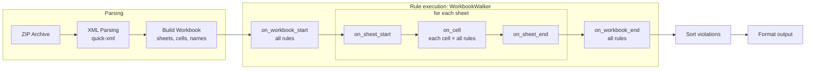

# Sheetlint Profiling & Architecture

This document captures performance profiling data and architectural insights for optimizing sheetlint.

---

## Profiling Results

> **Code state**: after #31 (per-cell formula allocations)  
> **Test file**: `TC2025 2025.12.05 Motor Tributi 1402 - MY- textos sin j.xlsx` (37 MB)  
> **Workbook stats**: 51 sheets, 4,453,591 non-empty cells, 1,855,268 formulas  
> **Build**: `profiling` Cargo profile with frame pointers

Shares are inclusive `perf` samples (a function plus its callees) over one run:

```bash
RUSTFLAGS="-C force-frame-pointers=yes" cargo build --profile profiling -p sheetlint
perf record -F 499 --call-graph fp ./target/profiling/sheetlint <file> > /dev/null
perf report --children --sort symbol -g none
```

### Phase Breakdown

| Phase | Share |
|-------|-------|
| **Parsing** (ZIP + XML → Workbook) | 11.8% |
| **Rule execution** (walker and violation sorting) | 80.6% |
| **Output formatting** (`print_human`) | 7.6% |

Parsing includes `translate_shared_formula` at 5.0%. A run with only FILE1001
enabled, a workbook-level rule, takes 4.2 s user time against the 39.5 s of
all rules in the #31 benchmark.

### Per-Rule Share (Descending)

| Rule | Share | Hooks |
|------|-------|-------|
| **CALC202** | 14.9% | `on_cell` 6.7%, `on_workbook_end` 8.2% |
| **REF301** | 14.8% | `on_cell` 1.3%, `on_workbook_end` 13.5% |
| **REF310** | 9.3% | `on_workbook_end` |
| **INT401–403** | 9.0% | `on_cell` 5.4%, `on_sheet_end` 3.7% |
| CALC201 | 4.6% | `on_cell` |
| VUL601 | 2.8% | `on_cell` 2.1%, `on_sheet_end` 0.7% |
| REF309 | 2.3% | `on_workbook_end` |
| VUL606 | 2.1% | `on_cell` |
| CALC205 | 2.0% | `on_cell` |
| ERR102 | 1.2% | `on_cell` |
| CPX504 | 1.2% | `on_cell` |
| DAT706 | 1.1% | `on_workbook_end` |
| DAT703 | 1.0% | `on_cell` |
| CALC204 | 0.8% | `on_cell` |
| CALC203 | 0.8% | `on_cell` |
| REF305 | 0.7% | `on_cell` |
| CPX507 | 0.6% | `on_cell` |
| DAT704 | 0.5% | `on_cell` |
| VUL604 | 0.5% | `on_cell` |
| REF304 | 0.5% | `on_cell` |
| EXT801 | 0.4% | `on_cell` |
| VUL602 | 0.4% | `on_cell` |
| VUL603 | 0.4% | `on_cell` |
| Other rules | <0.3% each | — |

CALC202, REF301, REF310, and INT401–403 account for 48% of samples. REF301's
`on_workbook_end` searches every collected formula for each defined name.

## Current Architecture

### Single-Pass Walker

Every rule implements `WalkerRule` (see [coding patterns](../../docs/coding-patterns.md#the-walker-pattern)).
`WorkbookWalker` traverses the parsed workbook once and calls each rule's hooks:


