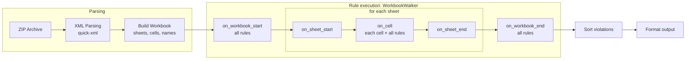

# Sheetlint Profiling & Architecture

This document captures performance profiling data and architectural insights for optimizing `sheetrs lint`.

---

## Profiling Results

> **Input**: `formulas.xlsx`, generated by `scripts/bench.py fixtures` (see
> [docs/performance.md](../../docs/performance.md#fixtures)): 5 sheets, 3,604,035 used cells, 2,400,005 formulas, 28 MB  
> **Build**: `profiling` Cargo profile with frame pointers, `scripts/benchmark.toml` as the configuration  
> **Run**: 8,525 samples at 499 Hz over one run (about 17 s)

Shares are inclusive `perf` samples (a function plus its callees) over one run. A virtual machine has no hardware
counters, so the profile samples the CPU clock:

```bash
CARGO_TARGET_DIR=target/fp RUSTFLAGS="-C force-frame-pointers=yes" cargo build --profile profiling -p sheetrs-cli
perf record -F 499 -e cpu-clock --call-graph fp ./target/fp/profiling/sheetrs lint -c scripts/benchmark.toml -i <file> > /dev/null
perf report --children --sort symbol -g none
```

The times and the memory of the whole tool are in [docs/performance.md](../../docs/performance.md#sheetrs-lint);
a change that targets the cost of a rule or a phase updates this profile.

### Phase Breakdown

| Phase | Share |
|-------|-------|
| **Parsing** (ZIP + XML → Workbook, `Book::workbook`) | 14.5% |
| **Rule execution** (`Linter::lint_workbook`: the walker and the violation sorting) | 78.7% |
| **Output formatting** (`write_report`) | 5.1% |

Parsing the formulas with `sheetrs_formula::parse` is 14.1% of all samples, spread over the rules that need a parse
tree (CALC202 and REF307 each parse every formula).

### Per-Rule Share (Descending)

| Rule | Share | Hooks |
|------|-------|-------|
| **INT401–403** | 15.8% | `on_sheet_end` |
| **CALC202** | 14.3% | `on_cell` 10.0%, `on_workbook_end` 4.3% |
| **REF307** | 8.2% | `on_cell` |
| CPX504 | 6.2% | `on_cell` |
| CALC201 | 4.0% | `on_cell` |
| CALC204 | 3.5% | `on_cell` |
| CALC203 | 2.7% | `on_cell` |
| CALC205 | 2.3% | `on_cell` |
| CPX507 | 2.1% | `on_cell` |
| VUL604 | 2.3% | `on_cell`, `on_sheet_end` |
| REF310 | 1.9% | `on_workbook_end` |
| VUL602 | 1.7% | `on_cell` |
| REF305 | 1.7% | `on_cell`, `on_sheet_end` |
| ERR102 | 1.5% | `on_cell`, `on_workbook_end` |
| VUL606 | 1.4% | `on_cell` |
| REF309 | 1.2% | `on_workbook_end` |
| EXT801 | 1.2% | `on_cell` |
| VUL601 | 1.1% | `on_sheet_end` |
| VUL603 | 1.1% | `on_cell` |
| Other rules | <1% each | — |

INT401–403 and CALC202 account for 30% of samples; the regular expressions of the formula scans (`regex`,
`CaptureMatches`) are 8%. What is left to gain: INT401–403 (the normalization of each formula), the two parses of
each formula (a parse shared through `LinterContext`, like `formula_upper`), and the searchers that CALC204, CALC205
and VUL604 build for each cell (3% of the samples in `StrSearcher::new`).

## Current Architecture

### Single-Pass Walker

Every rule implements `WalkerRule` (see [coding patterns](../../docs/coding-patterns.md#the-walker-pattern)).
`WorkbookWalker` traverses the parsed workbook once and calls each rule's hooks:


