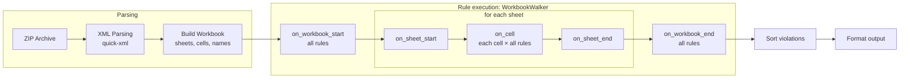

# Sheetlint Profiling & Architecture

This document captures performance profiling data and architectural insights for optimizing `sheetrs lint`.

---

## Profiling Results

> **Input**: `formulas.xlsx`, generated by `scripts/bench.py fixtures` (see
> [docs/performance.md](../../docs/performance.md#fixtures)): 5 sheets, 3,604,035 used cells, 2,400,005 formulas, 28 MB  
> **Build**: `profiling` Cargo profile with frame pointers, `scripts/benchmark.toml` as the configuration  
> **Run**: 15,053 samples at 499 Hz over one run (about 30 s)

Shares are inclusive `perf` samples (a function plus its callees) over one run. A virtual machine has no hardware
counters, so the profile samples the CPU clock:

```bash
CARGO_TARGET_DIR=target/fp RUSTFLAGS="-C force-frame-pointers=yes" cargo build --profile profiling -p sheetrs-cli
perf record -F 499 -e cpu-clock --call-graph fp ./target/fp/profiling/sheetrs lint -c scripts/benchmark.toml -i <file> > /dev/null
perf report --children --sort symbol -g none
```

The times and the memory of the whole tool are in [docs/performance.md](../../docs/performance.md#sheetrs-lint);
a change that targets the cost of a rule or a phase updates this profile.

### Phase Breakdown

| Phase | Share |
|-------|-------|
| **Parsing** (ZIP + XML → Workbook, `Book::workbook`) | 7.2% |
| **Rule execution** (`Linter::lint_workbook`: the walker and the violation sorting) | 87.8% |
| **Output formatting** (`write_report`) | 3.6% |

Parsing the formulas with `sheetrs_formula::parse` is 10.0% of all samples, spread over the rules that need a parse
tree.

### Per-Rule Share (Descending)

| Rule | Share | Hooks |
|------|-------|-------|
| **CALC202** | 26.9% | `on_workbook_end` 15.1%, `on_cell` 11.8% |
| **REF310** | 11.0% | `on_workbook_end` |
| **INT401–403** | 8.9% | `on_sheet_end` |
| REF309 | 4.8% | `on_workbook_end` |
| CALC201 | 4.5% | `on_cell` |
| VUL606 | 4.3% | `on_cell` |
| REF307 | 4.0% | `on_cell` |
| VUL601 | 3.1% | `on_sheet_end` |
| CPX504 | 2.9% | `on_cell` |
| CALC204 | 1.9% | `on_cell` |
| CALC203 | 1.4% | `on_cell` |
| CPX507 | 1.3% | `on_cell` |
| CALC205 | 1.2% | `on_cell` |
| VUL604 | 1.2% | `on_cell`, `on_sheet_end` |
| VUL602 | 1.0% | `on_cell` |
| REF305 | 0.8% | `on_cell`, `on_sheet_end` |
| ERR102 | 0.7% | `on_cell`, `on_workbook_end` |
| DAT704 | 0.6% | `on_cell` |
| EXT801 | 0.6% | `on_cell` |
| Other rules | <0.5% each | — |

CALC202 and REF310 account for 38% of samples; the regular expressions of the formula scans (`regex`) are 12%.

## Current Architecture

### Single-Pass Walker

Every rule implements `WalkerRule` (see [coding patterns](../../docs/coding-patterns.md#the-walker-pattern)).
`WorkbookWalker` traverses the parsed workbook once and calls each rule's hooks:


